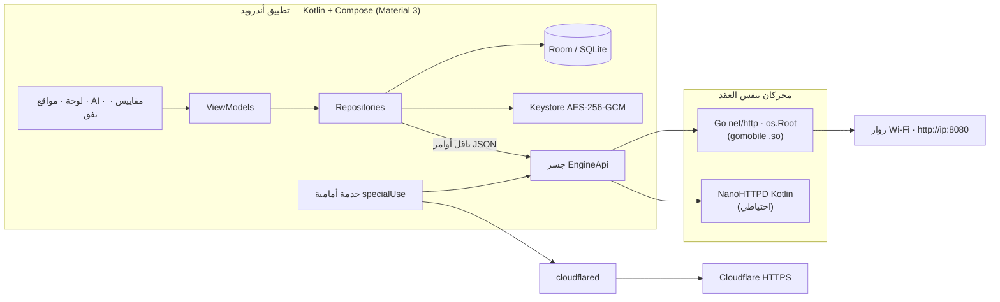

<div align="center">


# Stratos

**خادم الويب في جيبك — هاتفك. خادمك. بقواعدك.**
**Your phone. Your server. Your rules.**
**Cebinizdeki web sunucusu.**

حافٍ أندرويد كامل يحوّل هاتفك إلى خادم ويب حقيقي: استورد ZIP من أي أداة AI لبناء المواقع، اضغط «ابدأ الاستضافة»، وسيصبح موقعك حياً على شبكة Wi-Fi — وافتحه للعالم عبر Cloudflare Tunnel. بُني ليتفوق على PocketHost: محرك Go مدمج + محرك Kotlin احتياطي، بنّاء مواقع AI، محرر أكواد مدمج، ومقاييس لحظية.

</div>

<div align="center">

<p>
  
  
  
  
  
</p>
<p>
  
  
  
</p>

</div>

---

## 🇸🇦 العربية (اقرأني)

### ما هو ستراتوس؟

ستراتوس هو الإجابة على سؤال: *«أنشأتُ موقعاً بأداة AI… الآن كيف أنشره من هاتفي؟»*. بدل Termux أو VPS أو حسابات الاستضافة، يثبّت التطبيق محرك خادم HTTP **داخل التطبيق نفسه** ويشغّله بلمسة واحدة.

| الميزة | التفاصيل |
|---|---|
| 🚀 **محرك مزدوج** | محرك Go (مكتبة قياسية فقط) مدمج عبر `gomobile bind` + محرك Kotlin (NanoHTTPD) احتياطي يعمل من الصندوق بدون أي خطوة إضافية |
| 🔒 **استيراد ZIP آمن** | فحص ZIP-Slip والروابط الرمزية وقنابل الضغط والتشفير والأسماء المكررة وCRC32 لكل مدخل — قبل أن يلمس التخزين، والاستخراج ذرّي |
| 📥 **هدف مشاركة** | شارك أي ZIP من أي تطبيق (أو اضغطه في مدير الملفات) ← «مشاركة ← Stratos» فيُفتح معالج الاستيراد نفسه مباشرة |
| 📤 **تصدير المواقع** | أخرِج أي موقع كحزمة ZIP جاهزة لإعادة الاستيراد أو المشاركة — بياناتك تخرج بسهولة كما دخلت |
| 💾 **نسخ احتياطي ونقل** | كل المواقع + تفضيلات الخادم في أرشيف واحد: صدّره عبر منتقي النظام واستعده على أي جهاز — المواقع المستعادة تُضاف ولا تُستبدل، والأسرار (مفتاح AI، توكن النفق، كلمة الحماية) لا تترك الهاتف إطلاقاً |
| 🌐 **مواقع متعددة** | موقع افتراضي على `/` ومواقع ثانوية على `/s/<id>/` مع SPA fallback وETag/304 وgzip وRange و**فهرس مجلدات تلقائي** عندما لا يوجد index.html و**صفحة 404 مخصّصة** لكل موقع (404.html في الجذر) |
| 📊 **مقاييس صادقة** | طلبات، اتصالات نشطة، p50/p95/max، رموز الحالة، ذاكرة، تخزين، حرارة البطارية، شبكة — وإن منع النظام قياساً تُظهر «غير متاح» ولا تختلق أرقاماً |
| 🤖 **بنّاء مواقع AI** | الميزة الأقوى: صِف مشروعك فيولّد ستراتوس موقعاً كاملاً — **يعمل دون اتصال** بمولّد قوالب ذكي، أو عبر أي API متوافق مع OpenAI (Z.ai GLM / OpenAI / OpenRouter) بمفتاحك المشفّر |
| ✏️ **محرر أكواد مدمج** | شجرة ملفات + محرر sora-editor + **تلوين نحوي TextMate** (HTML/CSS/JS/JSON/MD/YAML/XML) متزامن مع الوضع الداكن + تحكم بحجم الخط والتفاف الأسطر + معاينة حية عبر الخادم الحقيقي على loopback |
| 🌍 **ثلاثي اللغات** | عربي (RTL كامل) + إنجليزي + تركي، بتبديل فوري داخل التطبيق |
| 🎨 **واجهة Stratos 2035** | زجاج شفاف فوق شفق قطبي حيّ، رصيف عائم متوهّج، وأزرار بطاقة طاقة متدرّجة — ثيم فاتح + داكن تلقائيًا |
| 🔐 **خصوصية مطلقة** | لا حسابات، لا إعلانات، لا تحليلات، لا تتبع. التوكنات مشفّرة بـ Keystore AES-256-GCM والسجلات معتّمة |
| ⛓️ **نفق Cloudflare** | نفق سريع برابط مؤقت `*.trycloudflare.com` بلا حساب، أو نفق مسمّى باسم نطاقك + **معالج نطاق مخصص** من 5 خطوات (فك معرّف النفق العام فقط → تعليمات CNAME → تحقق HTTPS فعلي) |
| 🎬 **تجربة إطلاق** | شاشة بداية متحركة بحلقة طاقة مدارية + شاشة ترحيب ثلاثية اللغات + جولة تعريفية بالتطبيق من 3 صفحات + شاشة أذونات تشرح «لماذا» قبل الطلب (إشعارات · ملفات الأندرويد القديم · خلفية بلا قيود) مع حالة حية وإمكانية «إعادة عرض المقدمة» من الإعدادات |

### المعمارية باختصار



### البناء من الصفر

**المتطلبات:** Android Studio (Ladybug أو أحدث) · JDK 17 · Android SDK 35 · اختياري: Go 1.24+ وNDK لمحرك gomobile.

1. افتح المجلد في Android Studio → انتظر المزامنة (Gradle 8.9).
2. شغّل `app` على جهاز ARM64 بنظام أندرويد 8.0+ — **يعمل فوراً بالمحرك الكوتلني**.
3. (اختياري، للأداء الأعلى) فعّل محرك Go:
   ```bash
   go install golang.org/x/mobile/cmd/gomobile@latest
   gomobile init
   ./scripts/build-engine.sh     # يشغّل الاختبارات ثم يبني engine/build/engine.aar
   ```
   سيالتقط `app/build.gradle.kts` ملف الـ AAR تلقائياً عند المزامنة التالية.
4. (اختياري، لنفق عام) ضع ثنائي `cloudflared` المبني لأندرويد arm64 في `filesDir/native/cloudflared` (يشرح `docs/ARCHITECTURE.md` كيف تبنيه)، أو استخدم النفق السريع بعد تثبيته.
5. جرّب بسرعة: `./scripts/make-demo-site.sh demo.zip` ثم استورد `demo.zip` من شاشة «المواقع».

**الاختبارات:**
```bash
cd engine && go test ./... -count=1      # 31 اختبار Go (خادم حقيقي + أمان ZIP + ناقل أوامر)
./gradlew :app:testDebugUnitTest         # اختبارات Kotlin (أمان ZIP، مسارات، تعتيم، قوالب AI)
```

### مقارنة مع PocketHost الأصلي

| | **Stratos** | PocketHost 1.0.5 |
|---|---|---|
| محرك الخادم | Go + **محرك Kotlin احتياطي يعمل فوراً** | Go فقط |
| بنّاء مواقع AI | ✅ دون اتصال + API مشفّر | ❌ |
| محرر أكواد مدمج | ✅ شجرة + تحرير + معاينة حية | ❌ (معاينة فقط) |
| اللغات | عربي RTL + EN + TR (تبديل داخل التطبيق) | TR + EN + 中文 (الموقع التسويقي فقط) |
| إدارة اللغات | `AppCompatDelegate` + `localeConfig` (مستوى النظام) | — |
| رمز QR للرابط المحلي | ✅ | ❌ |
| صفحات 404/ترحيب موسومة | ✅ | ✅ |
| فحص ZIP | ZIP-Slip، symlink، قنابل، CRC32، مكررات، تشفير، ذرّي | نفس النموذج |
| المعاينة | loopback فقط + `networkSecurityConfig` يمنع cleartext غيره | loopback فقط |
| التعبئة | AAR اختياري بالانعكاس — يبني بدون NDK | — |

### الأمان باختصار

- إدارة المحرك عبر **ناقل أوامر JSON فقط** (JNI) — لا واجهة HTTP إدارية إطلاقاً.
- حصر كل موقع بجذره عبر **`os.Root`** في Go وفحص `canonicalPath` في Kotlin.
- المعاينة مربوطة بـ loopback فقط، و`network_security_config` يسمح بـ cleartext لـ `127.0.0.1` وحده.
- توكن النفق ومفتاح AI في **Keystore** (غير قابل للتصدير)، ومستثنى من النسخ الاحتياطي، ومعتّمة في كل السجلات.
- الافتراضي: الشبكة المحلية فقط. النشر للعالم يتطلب موافقتك الصريحة على النفق.
- التفاصيل الكاملة: [`docs/SECURITY.md`](docs/SECURITY.md).

### خارطة الطريق

- [x] محرك مزدوج (Go + Kotlin fallback) بنفس العقد
- [x] بنّاء AI دون اتصال + API
- [x] محرر أكواد + معاينة
- [x] تلوين نحوي كامل في المحرر (TextMate grammars من vscode وRed Hat، ترخيص MIT)
- [x] معالج نطاق مخصص داخل التطبيق
- [x] استيراد عبر مشاركة الملفات (Share Target)
- [ ] نسخة سطح المكتب من المحرك (Go أصلاً cross-platform)

### الهيكل

```
Stratos/
├── engine/            # محرك Go (خادم، أمان ZIP، مقاييس، ناقل أوامر) + 31 اختبار
│   └── cmd/stratosd/  # مشغّل تجريبي من الطرفية
├── app/               # تطبيق أندرويد (Kotlin + Compose)
│   └── src/ (main|test)
├── docs/              # المعمارية والأمان
├── scripts/           # build-engine.sh · make-demo-site.sh
└── gradle/            # version catalog
```

---

## 🇬🇧 English

### What is Stratos?

Stratos answers: *"I built a site with an AI tool — how do I get it online from my phone?"* Instead of Termux, a VPS or a hosting account, Stratos embeds an HTTP server engine **inside the app process** and brings it up with one tap.

- **Dual engine** — a stdlib-only Go server (via `gomobile bind`) plus a pure-Kotlin NanoHTTPD fallback that runs out of the box. Same contract, zero UI difference.
- **Secure ZIP import** — zip-slip, symlinks, bombs, encrypted/duplicate entries and per-entry CRC32 are rejected *before* storage; extraction is atomic.
- **Share-target import** — share any ZIP from any app (or tap it in a file manager) → *Share → Stratos* opens the same guarded import flow; streams are staged into the app cache before parsing.
- **Site export** — any site leaves the same door it entered: the site menu packs its files back into a ZIP you save through the system picker — re-import it anywhere or share it as usual.
- **Full backup & migrate** — every site + the server preferences in one archive: export through the system picker, restore on any device. Restored sites are added, never overwritten (colliding ids get fresh ones), and secrets (AI key, tunnel token, protection password) never leave the phone — they are not part of the format.
- **Multi-site** — default site at `/`, secondary sites at `/s/<id>/`, SPA fallback, ETag/304, gzip, byte-range, a **branded auto-index** whenever a directory has no index.html, and a **per-site custom 404 page** (drop a `404.html` in the site root).
- **Honest metrics** — requests, active connections, p50/p95/max, status codes, memory, storage, battery temperature, network counters. What the platform hides is shown as *Unavailable*, never invented.
- **AI site builder (the killer feature)** — describe your project and Stratos generates a complete single-file site: fully **offline** via a smart template engine, or through any OpenAI-compatible API (Z.ai GLM / OpenAI / OpenRouter) with your key, AES-256-GCM encrypted on device.
- **Built-in code editor** — file tree + sora-editor + **TextMate syntax highlighting** (HTML/CSS/JS/JSON/MD/YAML/XML, official vscode/Red Hat grammars) synced with the dark theme + **persistent text-size and word-wrap controls** + live preview through the real server on loopback.
- **Stratos 2035 interface** — translucent glass over a living aurora backdrop, floating glowing dock, energy-sweep gradient CTAs; light + automatic dark.
- **Launch experience** — animated splash (orbital energy ring + version chip), trilingual welcome, a 3-page app tour, and a consent-first permissions screen that explains *why* before asking (notifications · legacy files · unrestricted background) with live status and a "Replay introduction" option in Settings.
- **Trilingual** — Arabic (full RTL), English, Turkish with in-app switching.
- **Cloudflare Tunnel** — Quick tunnel (temporary `*.trycloudflare.com`, no account) or Named tunnel for your own domain, with a **guided 5-step custom-domain wizard** (decodes only the public tunnel ID → CNAME instructions → live HTTPS verification).

### Download

One unified pipeline (`.github/workflows/build.yml`):

- Every push/PR: Go engine tests + Kotlin JVM tests (gates), then a debug APK under **Actions → Artifacts**.
- On a `v*` tag: the same gates, then a signed release APK (when the keystore secrets are configured; otherwise a clearly-labelled debug APK is published) attached to the GitHub **Release** with SHA-256 checksums. Current release: **`v1.0.0`**.

### Build

**Requirements:** Android Studio (Ladybug+), JDK 17, SDK 35. Optional: Go 1.24+ & NDK for the Go engine.

1. Open the folder in Android Studio → let Gradle 8.9 sync.
2. Run on an ARM64 Android 8.0+ device — it works immediately with the Kotlin engine.
3. Optional (max performance): `./scripts/build-engine.sh` — runs the Go tests and produces `engine/build/engine.aar`; the app picks it up automatically.
4. Optional (public URL): build/place `cloudflared` for android-arm64 (see `docs/ARCHITECTURE.md`) into `filesDir/native/cloudflared`.
5. Quick demo: `./scripts/make-demo-site.sh demo.zip`, then import it from **Sites → ➕**.

**Tests:** `cd engine && go test ./...` (31 tests, race-clean) · `./gradlew :app:testDebugUnitTest`.

### How it compares

| | Stratos | PocketHost 1.0.5 | Termux+nginx | Static host |
|---|---|---|---|---|
| Runs out of the box | ✅ (Kotlin engine) | Go build required | long setup | account + deploy |
| AI site builder | ✅ offline + API | ❌ | ❌ | ❌ |
| Code editor + live preview | ✅ | preview only | ❌ | web IDE varies |
| Languages | AR/EN/TR in-app | site only | — | — |
| Data stays on device | ✅ | ✅ | ✅ | ❌ |
| Real device metrics | ✅ honest | ✅ honest | ❌ | ❌ |

---

## 🇹🇷 Türkçe

### Stratos nedir?

Stratos şunu çözer: *"AI aracıyla bir site kurdum — telefonumdan nasıl yayınlarım?"* Termux, VPS veya hosting hesabı yerine Stratos, bir HTTP sunucu motorunu **uygulamanın içinde** gömer ve tek dokunuşla çalıştırır.

- **Çift motor** — yalnızca Go standart kütüphanesi (gomobile) + kutudan çıktığı gibi çalışan saf Kotlin (NanoHTTPD) yedek motoru. Aynı sözleşme, aynı arayüz.
- **Güvenli ZIP içe aktarma** — zip-slip, symlink, zip bombası, şifreli/tekrarlı girdiler ve CRC32, depolamaya dokunmadan reddedilir; çıkarma atomiktir.
- **Paylaşım hedefi** — herhangi bir uygulamadan ZIP paylaşın (veya dosya yöneticisinde dokunun) → *Paylaş → Stratos* aynı korumalı içe aktarma akışını açar.
- **Site dışa aktarma** — herhangi bir site girdiği kapıdan çıkar: site menüsü dosyaları sistem seçicisiyle kaydedebileceğiniz bir ZIP'e paketler.
- **Tam yedekleme ve taşıma** — her site + sunucu tercihleri tek arşivde: sistem seçicisiyle dışa aktarın, herhangi bir cihazda geri yükleyin. Geri yüklenen siteler eklenir, üzerine yazılmaz (çakışan kimlikler yenilenir) ve sırlar (AI anahtarı, tünel token'ı, koruma şifresi) telefonu terk etmez — biçimin parçası değildir.
- **Çoklu site** — varsayılan `/`, ikincil `/s/<id>/`, SPA fallback, ETag/304, gzip, byte-range; index.html olmayan dizinlerde **markalı otomatik dizin listesi** ve site köküne konan `404.html` ile **siteye özel 404 sayfası**.
- **Dürüst metrikler** — istekler, aktif bağlantılar, p50/p95/max, durum kodları, bellek, depolama, pil sıcaklığı. Platform gizlerse *Kullanılamıyor* yazar — asla uydurmaz.
- **AI site yapıcı** — projenizi anlatın; Stratos tam bir tek-dosya site üretir: **çevrimdışı** şablon motoruyla veya OpenAI-uyumlu API (Z.ai GLM / OpenAI / OpenRouter) ile; anahtarınız cihazda AES-256-GCM şifreli.
- **Dahili kod düzenleyici** — dosya ağacı + sora-editor + **TextMate sözdizimi renklendirme** (HTML/CSS/JS/JSON/MD/YAML/XML) + kalıcı yazı-boyutu ve satır-kaydırma denetimleri + loopback üzerinden canlı önizleme.
- **Üç dil** — Arapça (tam RTL), İngilizce, Türkçe; uygulama içi geçiş.
- **Stratos 2035 arayüzü** — canlı aurora üzerinde yarı saydam cam, yüzen ışıklı dock, enerji geçişli gradient düğmeler; açık + otomatik koyu tema.
- **Açılış deneyimi** — animasyonlu açılış ekranı (yörünge enerji halkası + sürüm rozeti), üç dilli karşılama, 3 sayfalık uygulama turu ve izinleri istemeden önce *neden*i açıklayan ekran (bildirimler · eski dosyalar · kısıtsız arka plan); canlı durum ve Ayarlar'da "Tanıtımı yeniden oynat".
- **Cloudflare Tüneli** — Hızlı tünel (hesapsız) veya kendi alan adınız için adlandırılmış tünel + **5 adımlı özel alan adı sihirbazı** (yalnızca genel tünel kimliği çözülür → CNAME talimatları → canlı HTTPS doğrulaması).

### Kurulum

1. Klasörü Android Studio'da açın → Gradle 8.9 eşitlemesi.
2. ARM64 Android 8.0+ cihazda çalıştırın — Kotlin motoruyla anında çalışır.
3. (İsteğe bağlı) `./scripts/build-engine.sh` → Go testleri + `engine.aar`.
4. (İsteğe bağlı) `cloudflared` ikili dosyasını `filesDir/native/` içine koyun.
5. Hızlı deneme: `./scripts/make-demo-site.sh demo.zip` → **Siteler → ➕**.

---

## License — الترخيص — Lisans

**MIT** — see [LICENSE](LICENSE). Stratos is an independent project, inspired by the public architecture documentation of PocketHost; it is not affiliated with Google, Android or Cloudflare. Cloudflare Tunnel is an optional third-party service subject to Cloudflare's terms.
